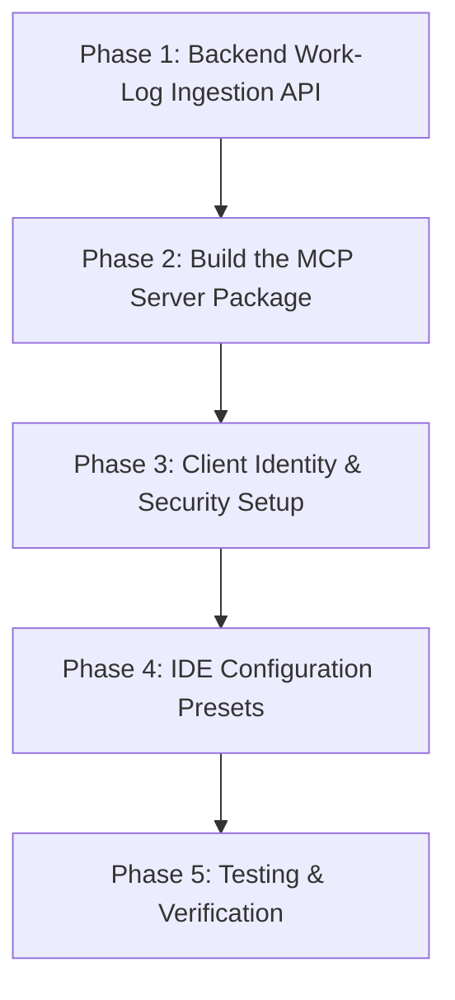

# Model Context Protocol (MCP) Integration Plan

This document outlines the architectural design, tool specifications, and phased implementation plan for integrating a **Model Context Protocol (MCP) Server** into the Analytics System. This enables developers to log their work and hours directly through AI-powered editors (Cursor, Claude Desktop, Antigravity, VS Code, Windsurf, Zed) using natural language.

---

## 1. Architecture Overview

```mermaid
flowchart LR
    subgraph Developer IDE
        Dev["Developer in Cursor / Claude / VS Code"]
        AI["AI Assistant (LLM)"]
        MCP["Your MCP Server (tracker-mcp)"]
    end

    subgraph Analytics Backend
        API["Next.js API (/api/work-logs)"]
        Cache["In-Memory RAM Cache"]
    end

    subgraph Cloud Storage
        Neon[("Neon PostgreSQL")]
    end

    Dev -->|"Log 2.5h on Ring Configurator for shader fix"| AI
    AI -->|Calls tool: log_work| MCP
    MCP -->|HTTP POST with Auth Token| API
    API -->|Insert row & update snapshot| Neon
    API -->|Refresh warm cache| Cache
    API -->>|Return confirmation| MCP
    MCP -->>|Formatted response| AI
    AI -->>|"Logged 2.5h! Total today: 7h"| Dev
```

### Architectural Principles
1. **API-Mediated Ingestion (Zero Direct DB Access for Clients)**:
   - Developers' local machines connect via a scoped HTTP API token rather than raw `DATABASE_URL` credentials.
   - Preserves database security, prevents accidental table drops, and ensures centralized business logic.
2. **Centralized Normalization & Validation**:
   - The backend validates fields via Zod, parses variable duration formats (`"2h 30m"`, `"2.5h"`, `"150m"`), resolves client/project associations, and computes duration in minutes.
3. **Instant Cache Synchronization**:
   - Submissions immediately invalidate and re-prime the backend's in-memory cache, ensuring live dashboard metrics on `http://localhost:3001` update in real-time.
4. **Fuzzy Project & Category Resolution**:
   - The MCP server tolerates natural language variations (e.g., `"ring"`, `"3d ring"`, or `"ring configurator"` all map to `3D Engagement Ring Configurator`).

---

## 2. MCP Tools Specification

The MCP Server exposes the following standard tools via `stdio` transport:

### 1. `log_work` (Primary Logging Tool)
Logs developer hours into the system.

- **Parameters**:
  - `developerName` *(string, optional)*: Name or email of the developer. Can be defaulted from environment variables (`DEVELOPER_NAME`).
  - `project` *(string, required)*: Project name or ID. Fuzzy-matched against active projects in the system.
  - `duration` *(string | number, required)*: Time spent. Supports flexible inputs (`"2.5h"`, `"2h 15m"`, `"90m"`, `1.5`).
  - `category` *(string, required)*: Work category (e.g., `Frontend`, `Backend`, `Bug Fix`, `Code Review`, `Meeting`, `DevOps`, `Design`).
  - `description` *(string, required)*: Detailed description of work performed.
  - `taskTicketId` *(string, optional)*: Ticket/Issue ID (e.g., `ENG-104`, `PROJ-42`).
  - `date` *(string, optional)*: Date in `YYYY-MM-DD` format. Defaults to current date in `Asia/Kolkata`.
- **Response**:
  - Confirmation status, logged hours, developer total hours for the day, and generated work log ID.

### 2. `list_projects`
Returns all active projects and their associated clients.
- **Parameters**: None.
- **Response**: List of `{ id, name, code, client }` objects to help the LLM autocomplete and validate project names.

### 3. `list_categories`
Returns the standardized list of task categories accepted by the system.
- **Parameters**: None.
- **Response**: Array of standard category names.

### 4. `get_my_logs`
Allows developers to query their recent submissions.
- **Parameters**:
  - `developerName` *(string, optional)*: Defaults to configured developer identity.
  - `days` *(number, optional)*: Number of past days to query (default: `1`).
- **Response**: Formatted list of recent logs and aggregate hours for the requested window.

---

## 3. Step-by-Step Implementation Roadmap



### Phase 1: Backend Ingestion API (`src/app/api/work-logs/route.ts`)
- Implement `POST /api/work-logs`:
  - Validate request payload using Zod.
  - Parse duration into exact minutes.
  - Insert row into Neon PostgreSQL `work_logs` table.
  - Recompute analytics snapshot and update `analytics_snapshots` in Neon.
  - Invalidate and refresh `NeonArtifactStorage` RAM cache.
- Implement `GET /api/work-logs`:
  - Filter logs by `developerName` and `dateRange` for status checks.

### Phase 2: Build MCP Server Package (`mcp-server/`)
- Initialize a lightweight Node.js package in `mcp-server/` with `@modelcontextprotocol/sdk` and `zod`.
- Implement `index.ts` registering tools: `log_work`, `list_projects`, `list_categories`, `get_my_logs`.
- Build executable script with `stdio` communication.

### Phase 3: Client Identity & Authentication
- Add optional `TRACKER_API_KEY` verification in API routes.
- Support `DEVELOPER_NAME` environment configuration per workstation.

### Phase 4: IDE Configuration Presets
Provide ready-to-use configuration files for developer environments:

#### Cursor (`cursor settings > Features > MCP`)
```json
{
  "mcpServers": {
    "project-analytics": {
      "command": "node",
      "args": ["<WORKSPACE_PATH>/mcp-server/build/index.js"],
      "env": {
        "TRACKER_API_URL": "http://localhost:3001/api",
        "DEVELOPER_NAME": "Your Name"
      }
    }
  }
}
```

#### Claude Desktop (`claude_desktop_config.json`)
```json
{
  "mcpServers": {
    "project-analytics": {
      "command": "node",
      "args": ["<WORKSPACE_PATH>/mcp-server/build/index.js"],
      "env": {
        "TRACKER_API_URL": "http://localhost:3001/api",
        "DEVELOPER_NAME": "Your Name"
      }
    }
  }
}
```

#### Google Antigravity / Gemini CLI (`.agents/mcp/`)
- Checked into VCS so team members get the MCP configuration automatically upon cloning.

### Phase 5: Verification & Testing
1. Test tool discovery and invocation with `@modelcontextprotocol/inspector`.
2. Test natural-language prompts in Cursor / Claude:
   > *"Log 2 hours on Ring Configurator fixing shadow map artifacts under Frontend."*
3. Verify live ingestion into Neon `work_logs` and instantaneous dashboard recalculation on `http://localhost:3001`.
